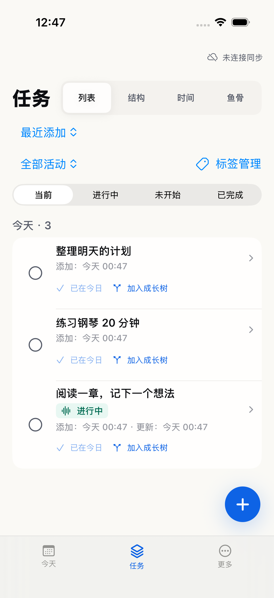
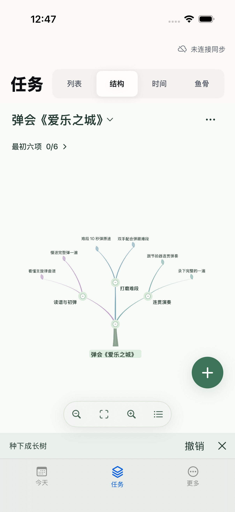

# Tough Trial

把想做的事记下来，选一件开始，把长期目标慢慢长成一棵树。

Tough Trial 是一款本地优先的 iPhone 与 Mac 任务工具。用「今天」专注眼前的事，用「任务」管理清单、成长树和真实用时。需要跨设备时，再连接自己的 GitHub 仓库。

## 下载

| 版本 | 平台 | 当前状态 |
| --- | --- | --- |
| 稳定版 · 免费 | iPhone / iPad，iOS 17 起 | 暂未上架；正在补充审核材料 |
| 稳定版 · 免费 | M 系列 Mac，macOS 14 起 | Mac App Store 与签名安装包准备中 |
| Tough Trial Preview | iPhone / Mac | 邀请测试准备中，仅本人及受邀者通过 TestFlight 安装 |

稳定安装包发布后会列在 [GitHub Releases](https://github.com/liuxiaoyusky/tough_trial/releases)。iPhone 通过苹果分发渠道安装；源码或 IPA 文件不等于可直接安装的 App。

## 三步开始

1. **记下来**：点击右下角「＋」，第一段写任务名，后面可补说明，保存。
2. **做一件**：把任务加入今日，在「今天」点击任务，再点「开始 / 继续」。切换任务时，上一件会暂停。
3. **留个记录**：做完点「完成」；完成的任务收进「已完成」，当天记录仍留在今天。想长期练习的事，可以加入成长树。

[看图上手](docs/getting-started.md) · [隐私政策](docs/store/privacy.md) · [帮助与反馈](docs/store/support.md)

## 真实界面

<table>
  <tr><th>今天 · 专注一件事</th><th>任务 · 管理清单</th><th>成长树 · 看见进展</th></tr>
  <tr>
    <td></td>
    <td></td>
    <td></td>
  </tr>
</table>

以上为 2026-10-24 的 iOS 1.0（40）Release 模拟器实拍，使用示例任务。Mac 新稳定版截图待补；未用手机截图代替 Mac 界面。

## 数据与测试版

任务默认留在本机，无须创建 Tough Trial 账号。文件导入导出、GitHub 同步均由你主动开启；GitHub 同步使用你选择的仓库，录音与附件不随日程同步。

稳定版首发聚焦任务、今日执行、成长树与同步。助手、转录等能力按验收结果分批进入 Preview。Preview 计划与稳定版并排安装、隔离数据；发布状态与本批开放内容以版本说明为准。

## 开发与许可

想自己构建，见 [开发说明](docs/development.md)。功能规划见 [Roadmap](docs/roadmap.md)。

本项目原始代码与文档采用 [Apache License 2.0](LICENSE)；第三方内容保留各自许可。
