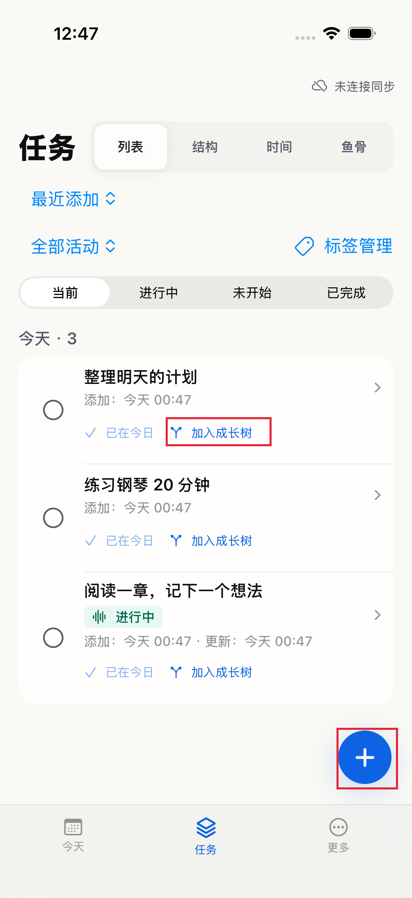
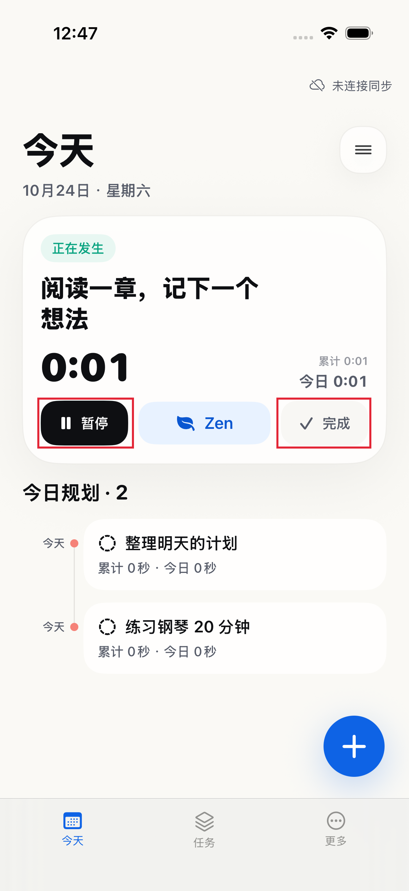
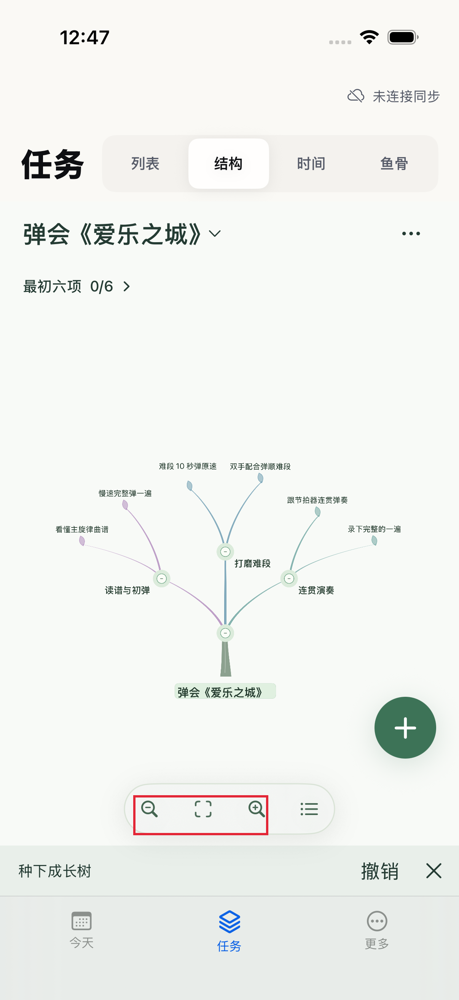

# 第一次使用 Tough Trial

先记一件小事，再开始计时。无需先配置 AI 或同步。

> 本页以 iOS 1.0（40）中文 Release 界面为例。图片拍摄于 2026-10-24，内容均为示例任务。稳定版仍在发布准备中；Mac 新稳定版的操作截图尚待补齐。

## 1. 创建第一件事

进入「今天」，点击右下角蓝色「＋」。第一段写任务名，例如「阅读一章，记下一个想法」，下面可补说明，然后保存。

保存后，任务出现在今日规划中。「任务 → 列表」也能找到它。下图展示创建后的真实列表；输入表单截图待补。

## 2. 开始，或先排进今天

在「今天」点击要做的任务，再点「开始 / 继续」。开始后，主卡片显示任务名和计时。

若任务是从清单创建的，进入「任务 → 列表」，点击该条目的「加入今日」；显示「已在今日」就表示已安排，不必重复添加。

临时离开就点「暂停」，做完点「完成」。新开始另一件任务时，上一件会暂停，保留已经记录的时间。撤销完成只恢复任务状态，不会自动重新开始计时。

## 3. 把长期方向长成树

在任务列表点击条目下方的「加入成长树」，先选择一棵树，再逐层选择放入的位置；也可以新建树。

打开「任务 → 结构」查看成长树。拖动画布查看分支，用底部放大、缩小和适配按钮调整视野。下面是《爱乐之城》的示例树。

## 可选：把手机和 Mac 连起来

在「更多」打开 GitHub 同步，按页面提示完成网页授权，再选择或新建自己的私有仓库。另一台设备连接同一个仓库，并按首次合并提示检查结果。

同步不是使用前提。首次连接、仓库选择与合并画面尚待按新稳定版补拍，本页不将已有登录状态当作首次授权教程。授权权限和数据范围见 [隐私政策](store/privacy.md)。

## 获取帮助

- 安装入口与系统要求：[项目首页](../README.md)。
- Preview 是邀请测试版，可能包含已知问题；请看对应版本说明再开始测试。
- 遇到问题时，附上版本号、所用平台、操作步骤和不含私人信息的截图，见 [帮助与反馈](store/support.md)。不要发送密码、Token 或完整私人任务库。
